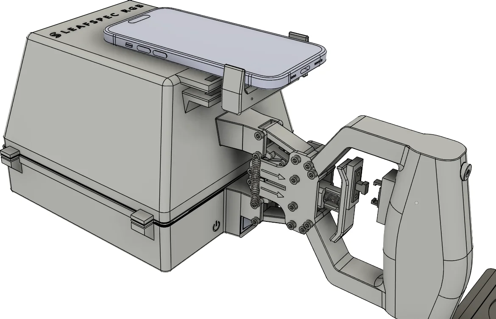
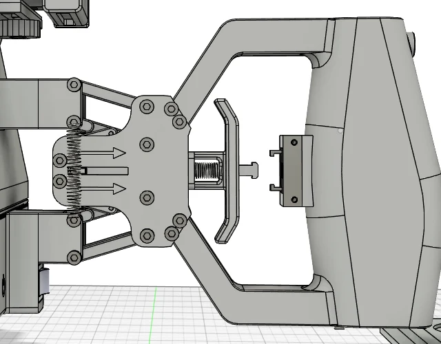
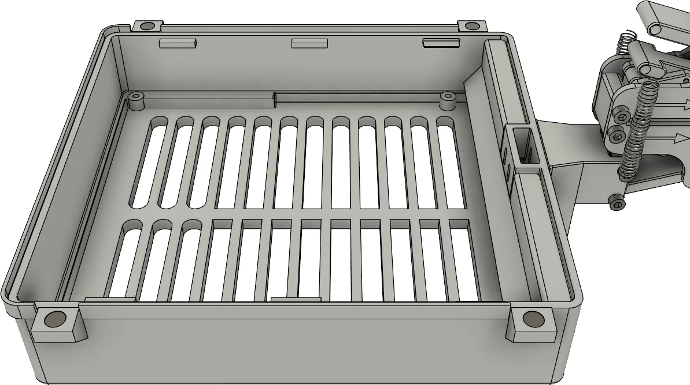
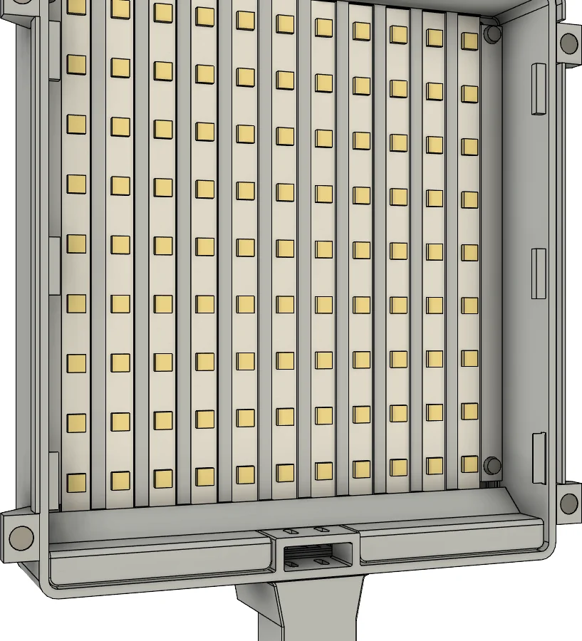
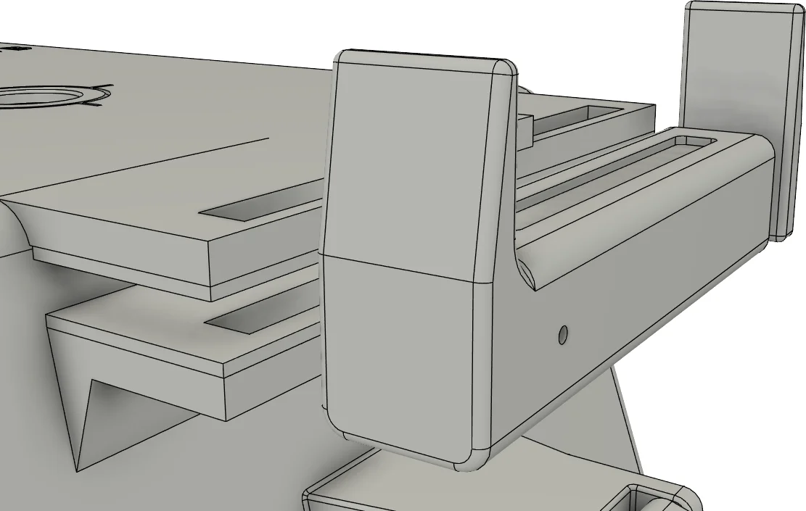

# LeafDoc hardware: LeafStudio lightbox (Proto 1)

This folder holds the handheld imaging enclosure that the LeafDoc app is built around: the editable CAD, ready-to-print STL files, and the design notes needed to build, test and keep developing it.

**Status (2026-11-20):** Proto 1, in build. The goal is two fully working, hand-assembled units before Thanksgiving 2026, then refining the design so it can be sold. Everything here reflects the CAD as of 2026-11-18 (centred latch with a retainer cap, product renamed from LeafSpec RGB to **LeafStudio**).

---

## Contents

| Path | What it is |
|---|---|
| `cad/LeafDoc_Proto_1.f3d` | Autodesk Fusion archive of the full assembly ("LeafDoc Proto 1"). Open with **File → Open → Open from my computer**. |
| `print/*.stl` | Print-ready parts, numbered 01–21 (14 and 15 are a rejected concept and 20 is a retired strike; none of them are included). Most are already in print orientation. |
| `print/parts_list.txt` | The working parts list: quantities, sizes, orientation and a per-file change log. |
| `images/` | CAD screenshots used in this document. |

---

## 1. What the device does

The lightbox gives any smartphone a controlled "studio" for photographing a single leaf:

- The leaf lies on a backlit, diffused **15 × 15 cm window** inside a light-tight box.
- The phone lies flat on the lid, camera looking straight down through a Ø15 mm hole, so working distance, angle and lighting are the same on every shot.
- The box is **clamped shut at rest**. Pulling the spring-loaded handle opens it so a leaf can be inserted; a push-push latch can hold it open.
- The LEDs only light when the **power switch is on and the box is closed** (limit switch), which saves battery and removes ambient light from every capture.

Consistent lighting and geometry matter more than raw brightness: they make images comparable for the AI diagnosis in the app.

---

## 2. Key specs

| Item | Value |
|---|---|
| Imaging window | 150 × 150 mm design area; 135 × 145 mm actually lit through the diffuser (parametric: `imaging_length`, `imaging_width`) |
| Box opening | 38.2 mm lid lift for a 16.55 mm handle pull; the lid lifts straight up |
| Light | 11 × 150 mm strips of 12 V COB LED strip (8 mm, 320 LED/m, 4000 K, CRI 90), about 23 mm under a 2 mm opal diffuser sheet |
| Power | 9 V battery in the handle → 12 V boost converter(s) on the back of the LED plate |
| Latch | Sugatsune ESN-195-3.1 push-push catch (3.5 kgf), held by a screwed retainer cap; strike printed as part of the trigger; both on the trigger spring line |
| Rim seal | 1/16 in felt tape + 4 pairs of 6 × 3 mm N52 magnets + 1.2 mm light-trap skirt |
| Phone mount | Original spring clamp on a cross-slot shuttle: x ±35 mm, y ±5 mm travel, thumb-knob lock |
| Printer / material | Bambu Lab P2S, 0.4 mm nozzle, 0.2 mm layers, PLA-CF (black) |

---

## 3. Mechanism

### 3.1 Pull handle and parallelogram links

The mechanism is the original pull-handle design from the first prototype (a v2 linkage and a v3 pistol grip were tried and rejected; their parts are still in the CAD, hidden and named `OLD …`).

- **Frame:** D-shaped handle, two side plates, guiding rod and battery cap.
- **Trigger:** the Sliding Rod runs on the guiding rod. Pulling it toward the handle opens the box.
- **Box suspension:** each box half (lid = `Top Box`, light box = `Bottom Box`) hangs on a parallelogram of **Link A + Link B** (30 mm pivot centres), so the lid stays parallel to the light box. A **drive link** runs from a pin on the slider to the middle of each Link A. Link A swings about 51° over the stroke.
- **Stroke → opening:** 16.55 mm of pull opens the box by 38.2 mm. Both halves shift by the same amount in x, so the lid lifts straight up relative to the light box.
- **Leverage changes a lot over the stroke:** about 6.3 mm of opening per mm of pull near closed, 2.5 mid-stroke and 0.9 in the last 0.5 mm. This explains why the old prototype snapped shut hard and stuck at full pull. The springs below are arranged to deal with it.

In Fusion the slider joint is **`v1 Trigger Slider - Guide Rod`**: **−16.547 mm = closed (rest)**, **0 = fully open**.

### 3.2 Springs

There are three springs, all pulling toward closed:

- **2 box extension springs** between the upper and lower box brackets, hooked on the screws at the **Link A box pivots** (stainless M3 × 30 with a 1.5 mm stand-off under the head and the nut).
- **1 trigger return spring** (compression, on the guiding rod). It acts 1:1 on the slider, so it is the main cure for the handle sticking at full pull.

The spring coils in the CAD are visual only. Their lengths are driven by `spr_*` parameters, not by the joint (rest: `spr_mid_len` 12.64, `spr_box_len` 38, `spr_box_dx` 0, `spr_box_dz` 0; full open: 29.19 / 76.16 / 17.5 / −19.08).

### 3.3 Push-push latch (revised 2026-11-18)

- **Why it changed:** on the first build the whole catch pulled out of the handle under the box springs (its snap barbs folded over the soft printed edge), and the screw-on printed strike sometimes slipped out of the jaws. The strike sat about 16 mm above the spring line, so the spring load twisted the trigger and pulled the strike out at an angle.
- **Centred:** the return spring and both drive-link pins pull at z ≈ 76 mm, so the catch and strike now sit exactly there. The catch moved 16 mm down and 1.9 mm toward the trigger (the battery cavity is right behind it; about 1 mm of wall is left behind the catch tail, which carries no load).
- **Catch:** Sugatsune **ESN-195-3.1** (non-magnetic jaw type, 3.5 kgf) in a new collar on the handle. Its flange sits flush in a 1.8 mm counterbore; the snap-in cut-out is 10.1 × 11.1 mm in a 2 mm panel.
- **Retainer cap (`21_Latch_Retainer_Cap.stl`, new):** a 1.2 mm plate over the catch flange with a 6.4 × 18 mm window for the jaws and strike. It covers the flange on both sides and wraps the collar, held by **4 × M2 × 6–8 screws** through its side skirts (they load in shear). The catch can no longer pull out; the barbs only hold it during assembly.
- **Strike:** now **printed as part of the trigger** (`10_Sliding_Rod_trigger.stl`), no screws. Head 6.3 mm / neck 4.1 mm (the sizes test-fitted on 2026-11-17), a square shoulder with a slight (~8°) undercut so pulling draws the jaws closed, and a 0.8 mm chamfered nose for an easy lead-in. **Print the trigger with the strike lying flat on the bed** so layer lines don't run across the neck. The old screw-on strike bracket is removed from the trigger.
- **Clearance:** at full pull the trigger stops 0.58 mm short of the cap. Interference checked at rest, first contact, latched and full pull.
- **Timing as modelled (unchanged):** the strike touches the catch at 9.5 mm of pull and latches at 13.7 mm (box 35.3 mm open). The last 2.8 mm of pull is the over-travel used to lock and to release.
- **Backup part:** Sugatsune MC-20 (4 kgf) if the springs turn out stronger than about 2.5 kgf at full open.
- The catch internals in the CAD are animated with parameters `esn_dx` (0 / 4.2 / 7.0) and `esn_jaw_open` (3.1 / 0), not joints.

### 3.4 Rim seal (light-tightness)

- **Felt tape:** 1/16 in adhesive felt slit to about 2.5 mm, on the light-box rim. The rim is lowered by `seal_drop` = 1.3 mm (rim top at box z 38.7), which squeezes the felt about 13–18 % when closed. For another felt thickness *t*, use `seal_drop` ≈ 0.85 t − 0.02.
- **Light-trap skirt:** a 1.2 mm skirt on the light box overlaps the lid wall by about 1.5 mm (long sides and far end; not on the handle end).
- **Magnets:** 4 pairs of 6 × 3 mm N52 discs in bosses on both halves (Ø6.2 × 3.1 pockets). Glue them in with opposite poles facing. About 0.4–0.5 kgf per pair when closed.
- The original clip tabs were removed.

---

## 4. Light box (bottom box)

Coordinates in this section are in the Light Box's own frame, in mm: x across the box, y along it (handle end is −y; inner end walls at y −70 and 96.5), z up (floor top z 5, rim z 38.7).

### 4.1 Box

- Full-floor **grill** (12 rows × 2 slots, 7.5 mm wide, 11.25 mm pitch, 6 mm centre spine). The old inner thin wall was removed.
- **4 risers** Ø7 × 5.5 mm at (±70.5, −47) and (±70.5, 90), each with a blind Ø2.6 pilot for an **M3 × 10** button-head screw. They hold the LED plate 5.5 mm above the floor, which leaves room for the converter underneath.
- **Diffuser support knubs: 3 per side** (y −50…−35, 5.75…20.75 and 61.5…76.5), spread evenly so the acrylic diffuser doesn't sag in the middle. Parameters `knub_len`, `knub_end_gap`, `knub_y_mid`, `knub_y_far`.
- **Branding:** power symbol beside the rocker switch; underside label (leaf mark, LEAFSTUDIO, MODEL P1 · 9 V) and a 30 × 10 × 0.4 mm serial-number sticker recess. The lid top carries the LEAFSTUDIO wordmark and leaf mark, engraved 0.6 mm:

### 4.2 LED strip plate (`16_LED_Strip_Plate.stl`)

- 2.5 mm plate, x ±74.4, y −54.95…96, screwed to the 4 risers (z 10.5–13).
- **11 channels run along the box** (y), 8.4 wide × 1 mm deep, 12.5 mm pitch (x 0, ±12.5 … ±62.5), y −54.7…95.7. Each takes a **150 mm strip = 3 × 50 mm cut segments** of the COB strip. (A horizontal layout was tried on 2026-11-16, but with 50 mm cut marks only 100 mm strips fit across the box, which left the window edges dim.)
- **Reflector rib:** a small rib at the handle end seats the foot of the Reflective Panel. It is notched at every channel so the strips can start under the panel foot; the rib pieces between the strips still support the panel.
- **Wiring:** there's about 0.5 mm at the handle end and 1 mm at the far wall, so solder the joints flat on the strip-end pads and bridge between strips on top. **4 through-notches** (3 mm, `led_notch_w`) at the plate's side edges, two at each end, let wires wrap to the back of the plate where the converter sits.
- The plate covers the whole grill, so no outside light gets in through the floor.
- Parameters: `led_count` 11, `led_pitch` 12.5, `led_strip_w` 8, `led_chan_d` 1.0, `led_chan_hl` 75.2, `led_y_c` 20.5, `led_plate_t` 2.5, `led_notch_w` 3.

### 4.3 Diffuser frame (`17_Diffuser_Frame.stl`) and Reflective Panel (`03`)

- The frame top is flush with the rim. It sits on the knubs (notches match the 3-per-side layout) and has a notch around the limit-switch housing.
- Its pocket holds a **140 × 150 × 2 mm opal diffuser sheet** flush with the rim, leaving a 135 × 145 mm lit window. The knubs limit the sheet to about 142 mm wide.
- Over the Reflective Panel the frame steps down to 1.7 mm and rests on the panel top.
- The **Reflective Panel** (from the original design) is the angled panel at the handle end, above the rocker switch and limit switch. It is kept.

---

## 5. Phone clamp and cross-slot shuttle

The phone lies on the lid, camera down over the Ø15 hole at lid (0, 6.25), held by the original spring clamp: **Linkage 4** (housing + fixed jaw) and **Linkage 5** (sprung sliding jaw).

- **Cross-slot shuttle:** a 4.8 mm square key runs in a **slot across** the two lid lugs (75.4 × 5.4 mm) and a **slot along** the clamp boss (5.4 × 15.4 mm). The clamp can move x ±35 mm (`cs_tx`) and y ±5 mm (`cs_ty`) but can't rotate, so any phone's lens can be lined up with the hole. More y adjustment comes from sliding the phone in the jaws.
- **Lock:** an M3 × 25 countersunk screw goes up through the printed **Clamp Knob** (locked to it with a jam nut), through the bottom lug, clamp boss and top lug, into a captive M3 nut in the shuttle flange. Turn the knob to lock or unlock with the phone in place. The key stops 1.5 mm short of the bottom of the stack (`cs_key_gap`) so the screw clamps the lugs, not the key.
- **Lugs (2026-11-16):** both lugs are **5 mm thick** (`cs_lug_t`, was 3.75) and the **top lug now sticks out as far as the bottom lug** (3 mm of material beside the slot, was 2). Earlier the top lug flexed when the clamp moved. The lugs grew into the gap between them and the clamp boss was thinned to 4.6 mm, so the clamp height, shuttle, knob and screw are unchanged. A 20 mm sloped gusset supports the bottom-lug root.
- **Jaw fit (2026-11-16):** the Linkage 5 jaw bar is 0.15 mm smaller per side (`jaw_bar_shrink`): 9.45 mm square in a 10.0 mm housing, because the first print was too tight.
- Interference is clean at all clamp travel corners.

---

## 6. Electronics (in progress)

Not modelled in CAD yet. Current plan and findings:

- **Switching:** 9 V battery (in the handle) → rocker switch (McMaster 7395K28) → limit switch (closed only when the box is shut) → boost converter → LED strips.
- **Converter:** the strips are 12 V, so a **boost (step-up)** converter is needed, not a buck. It must fit in the **5.5 mm gap under the LED plate**.
  - Candidate: generic 1.5 A mini boost modules with 5/8/9/12 V solder-pad selection (22 × 11 × 3.6 mm, input 2.5 V to Vout − 0.5 V, 1.5 A switch limit). One board is marginal for all 11 strips, so use **two boards**, each powering about half of the strips. **Don't connect their outputs together.**
  - Alternative: Pololu U3V40F12 (fixed 12 V, 15.2 × 15.2 mm, about 3.5 A input). Check its height before using it.
  - Avoid the common MT3608 module: 37 × 17 × 7 mm is too tall for the gap.
- **Load estimate:** 11 × 150 mm = 1.65 m of strip. Spec sheets for 320 LED/m COB strip say about 8 W/m, and one buyer measured this brand at about 4.6 W/m, so expect roughly **7.5–13 W at full 12 V**. Running a little dimmer is fine for imaging.
- **Battery life (estimate):** an alkaline 9 V gives roughly 10–20 min of continuous light; a lithium 9 V (Energizer L522) roughly 40–60 min and holds its voltage better under load. With the light on only while the box is closed (about 20 s per capture), that's very roughly 30–60 captures per alkaline and 120–180 per lithium. **Measure the real battery current** once wired; if it's over about 1 A, dim the strips.

---

## 7. Printing

Printer settings used: Bambu Lab P2S, 0.4 mm nozzle, 0.2 mm layers, PLA-CF. Quantities are **per unit**; double them for two units. Sizes are X × Y × Z in mm.

| File | Qty | Size | Orientation / notes |
|---|---|---|---|
| 01_Bottom_box_Light_Box | 1 | 173 × 203 × 41.5 | Rim up, as exported. Re-slice from the STL (older slicer projects are out of date). Underside label reads LEAFSTUDIO. |
| 02_Lid_Image_Box_2nd_Gen | 1 | 173 × 201.5 × 92.5 | Rim down, as exported. **Support under both clamp lugs**; the gusset is self-supporting. LEAFSTUDIO wordmark on top. |
| 03_Reflective_Panel | 1 | 149.5 × 24.5 × 16 | From the original design. |
| 04_Lid_bracket_Linkage_4 | 1 | 38.4 × 30 × 70 | Clamp housing + fixed jaw. |
| 05_Lid_bracket_Linkage_5 | 1 | 47.5 × 30 × 15 | Sliding jaw. |
| 06_Handle | 1 | 109.8 × 120.4 × 27.2 | Centred latch collar for the ESN-195 catch, with M2 pilot holes for the retainer cap. |
| 07_Side_Plate | 2 | 54.8 × 60 × 10.1 | Pull arrows engraved on the outer face. |
| 08_Guiding_Rod | 1 | 15 × 16.5 × 58.5 | |
| 09_Battery_Cap | 1 | 36 × 2.5 × 18 | |
| 10_Sliding_Rod_trigger | 1 | 21 × 57.3 × 75.3 | Strike is part of the trigger. Print with the strike lying flat on the bed. |
| 11_Link_A_Linkage_1 | 2 | 35 × 5 × 14.6 | Top + bottom. |
| 12_Link_B_Linkage_3 | 2 | 35 × 5 × 14.6 | Top + bottom. |
| 13_Drive_Link_Linkage_2 | 2 | 20 × 5 × 14.6 | Top + bottom. |
| 16_LED_Strip_Plate | 1 | 148.8 × 151 × 4.4 | Flat side down, channels up. |
| 17_Diffuser_Frame | 1 | 149.4 × 165.9 × 3.4 | Already flipped: top face down. |
| 18_Clamp_Shuttle | 1 (+1) | 12 × 12 × 17 | Flange down. Press an M3 nut into the flange pocket. |
| 19_Clamp_Knob | 1 (+1) | 17.8 × 17.8 × 6.6 | Countersink face down, no support. |
| 21_Latch_Retainer_Cap | 1 (+1) | 7.4 × 18.4 × 28 | Exported in assembly orientation: lay the 1.2 mm front plate flat on the bed; skirts up, no support. |

Export check: every STL's volume was compared against its CAD body before release.

---

## 8. Bill of materials (per unit, not printed)

| Qty | Item |
|---|---|
| 1 | Sugatsune ESN-195-3.1 push-push catch (the strike is printed on the trigger) |
| 4 | M2 × 6–8 pan-head or self-tapping screws (latch retainer cap) |
| 1 | Rocker switch, McMaster 7395K28 |
| 1 | Limit switch (in the housing at the handle end) |
| 1 | 9 V battery (lithium recommended) + snap |
| 1–2 | 12 V boost converter (see section 6) |
| 1.65 m | 8 mm 12 V COB LED strip, 320 LED/m, cut into 11 × 150 mm |
| 1 | 140 × 150 × 2 mm opal (white diffusing) acrylic sheet |
| 8 | 6 × 3 mm N52 disc magnets (4 pairs) |
| ~0.65 m | 1/16 in adhesive felt tape, slit to ~2.5 mm |
| 3 | Springs: 2 box extension + 1 trigger return (compression) |
| 12 | M3 × 20 socket head (black): 4 frame pivots, 4 handle mounts, 2 guide-rod mounts, 2 Link B box pivots |
| 2 + 2 | M3 × 30 socket head (stainless) + nuts: Link A box pivots, springs hook on them |
| 4 | M3 × 10 button head (LED plate) |
| 1 | M3 × 25 countersunk (ISO 10642) + 2 M3 hex nuts (clamp lock) |
| 4 | Ø1.5 drive-link pins (2 mm planned) |
| 3 | M2 × 8 (battery cap, assumed) |

All pivot and mount screws are M3 socket head with the heads on the same side, threading into Ø2.6 pilots (Ø3.0 for the handle and guide-rod mounts).

---

## 9. Assembly outline

1. **Light box:** glue in the 4 magnets (note polarity), stick felt tape on the rim, fit the rocker switch and limit switch.
2. **LED plate:** cut 11 × 150 mm strips on the cut marks, stick them in the channels, solder the strip ends together, route the leads through the edge notches to the converter(s) on the back. Screw the plate to the risers with 4 × M3 × 10.
3. **Reflective Panel** onto the rib, then the **diffuser sheet** into the **diffuser frame**, and drop the frame onto the knubs.
4. **Lid:** glue in the 4 matching magnets. Assemble the clamp: Linkage 5 into Linkage 4, shuttle key through the top lug, clamp boss and bottom lug, then the knob and screw from below (jam nut in the knob, captive nut in the shuttle).
5. **Frame and trigger:** catch into the handle collar (flange flush in the counterbore), retainer cap over it with 4 × M2 screws (check the jaws open freely through its window), trigger + return spring onto the guiding rod, side plates, links and drive links (M3 screws and drive-link pins).
6. **Hang the boxes** on the Link A/B box pivots, hook the 2 box springs on the M3 × 30 Link A pivot screws.
7. **Battery and wiring** in the handle; test the switch logic (on only when the switch is on and the box is closed).

---

## 10. Testing checklist

- Box closes square and light-tight (check in a dark room with the LEDs on).
- Handle returns smoothly from full pull; no sticking at full open.
- Latch: the catch must stay put under load (retainer cap) and the strike must not slip out of the jaws. Measure the spring pull at full open (luggage scale); under ~2.5 kgf is fine for the 3.5 kgf catch. Check where it actually latches and adjust the strike length if needed.
- Clamp: jaw slides freely; knob lock holds the phone under handling (add a rubber washer if it slips); lugs no longer flex.
- Lighting: even across the window; measure battery current.

---

## 11. Working with the Fusion model

- Document: **LeafDoc Proto 1**. Units are mm (the Fusion API uses cm).
- **`STEP Import (keep):1` is hidden. Never delete it:** it owns the original components, and deleting it deletes every part.
- Rest pose: slider joint `v1 Trigger Slider - Guide Rod` = −16.547 mm.
- After changing features or parameters, as-built joints can snap to another pose. Re-drive the slider back to rest in small steps.
- Components named **`VIS … (display only)`** (screws, magnets, felt, LED strips, diffuser sheet, nuts) are for renders only. **Never print or export them.**
- Components named **`OLD …`** are rejected designs kept for reference (hidden).
- Many suppressed features from the old v2/v3 designs show as unhealthy in the timeline. That is expected.

### Main user parameters

| Group | Parameters |
|---|---|
| Imaging area | `imaging_length`, `imaging_width` (150). Don't edit `orig_*`. |
| Clearances | `slide_clearance` 0.3, `pin_clearance` 0.15, `pin_hole` 3.3, `frame_hole` 3.1, `link_width` 8, `plate_thk` 2.5 |
| Rim | `seal_drop` 1.3, `mag_d` 6, `mag_h` 3, `mag_clear` 0.2, `mag_gap` 1 |
| Light box | `riser_d` 7, `riser_h` 5.5, `riser_pilot` 2.6; `knub_len` 15, `knub_end_gap` 20, `knub_y_mid`, `knub_y_far` |
| LED plate | `led_count` 11, `led_pitch` 12.5, `led_strip_w` 8, `led_plate_t` 2.5, `led_chan_d` 1.0, `led_chan_hl` 75.2, `led_y_c` 20.5, `led_notch_w` 3 |
| Diffuser | `dif_sheet_t` 2, `dif_sheet_w` 140, `dif_sheet_l` 150, `dif_lip` 1.4, `dif_ledge` 2.5 |
| Clamp shuttle | `cs_tx` 35, `cs_ty` 5, `cs_key` 4.8, `cs_clear` 0.3, `cs_ys` −69.5, `cs_lug_end` 9, `cs_lug_hw`, `cs_lug_t` 5, `cs_bot_tip` 5.7, `cs_gus_clear` 1.5, `cs_gus_h` 20, `cs_key_gap` 1.5, `cs_flange_t` 3.5, `cs_nut_af` 5.7, `cs_nut_d` 2.5, `cs_knob_d` 18, `cs_knob_t` 6.6, `cs_knob_nut_d` 2.6 |
| Clamp jaw | `jaw_bar_shrink` 0.15 |
| Branding | `brand_*`, `rev_*`, `lens_ring_*`, `label_sn_depth` (wordmark text is in sketch `Brand - LeafStudio text`) |
| Animation only | `esn_*`, `spr_*` |

---

## 12. Design decisions and history

| Date | Decision |
|---|---|
| Early Nov 2026 | Rebuild the SolidWorks prototype in Fusion; target normal leaves (e.g. grape) instead of corn, drop the pinch rollers; 15 × 15 cm imaging area. |
| 2026-11-06 | v2 linkage and v3 pistol grip explored and rejected; back to the original pull handle. |
| 2026-11-10 | Sugatsune ESN-195-3.1 latch chosen. Clip tabs removed; felt seal, light-trap skirt and rim magnets added. |
| 2026-11-11 | Light box rebuilt inside: full grill, risers, LED strip plate, diffuser frame. |
| 2026-11-12 | X-Y phone slide and universal phone mount rejected; original clamp kept on a cross-slot shuttle. |
| 2026-11-13 | Shuttle travel widened to ±35 mm; clamp lock fixed (key was bottoming on the nut); lugs strengthened; branding (then "LeafSpec RGB"), icons and labels; old LED board removed. |
| 2026-11-16 | From the first test prints: 3 diffuser knubs per side, easier clamp jaw slide, 5 mm lugs with the top lug extended, LED strips re-laid as 11 × 150 mm along the box (strip cuts every 50 mm), wire notches for a converter on the back of the plate; Reflective Panel kept. |
| 2026-11-17 | Printable copy of the ESN-195-ST strike added (file 20). |
| 2026-11-18 | Latch catch pulled out of the handle and the strike slipped on the first build: catch and strike moved onto the spring line, strike made part of the trigger (file 20 retired), screwed retainer cap added (file 21), old strike bracket removed. Product renamed **LeafStudio** (lid wordmark and underside label). |

---

## 13. Open items

1. Print and test the 2026-11-16 and 2026-11-18 changes (jaw fit, lug stiffness, LED wiring and converter fit; latch: cap window vs. the real jaws, strike hold under load).
2. Electronics: choose the converter(s), wire the switch and limit switch, measure current and battery life.
3. Latch: measure spring pull at full open; confirm the real latch point.
4. Hinge tolerance fixes, **not yet applied**: Link A/B holes → Ø3.4; drive-link pins → 2 mm in Ø2.4 holes; shift the bottom drive link +0.25 mm in y; 0.4 mm chamfer on link edges.
5. Decide which phone lens is centred over the camera hole.
6. Confirm the final diffuser sheet size.
